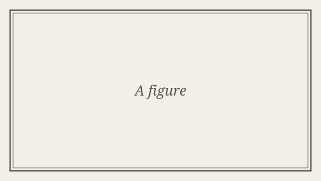

# Writing a Page for This Site

A page is a folder in `page-content/` holding an `index.md`, the images it
uses, and (if you want one) a `style.css` of its own.[^1] The title, authors,
date and abstract come from the front matter at the top of the file; the
site draws the byline, the "How to cite" block and the footnotes for you.

## Links into the database

Link to any record by its address on the site: [the Cathedral of the Immaculate Conception, Albany](/institutions/alb.ny.0001)
is an institution and [Bishop Benedict Fenwick](/people/ben_j_fenwick_901) is a person. Links that
start with `/` stay inside the site; links that start with `http` open
elsewhere.

“The almanac was published every year from 1833, except in the war years of 1862 and 1863.”

## A record card and an embedded visualization

A live card for any institution or person, as of a year:

<almanac-record record="alb.ny.0001" year="1850"></almanac-record>
<almanac-record record="ben_j_fenwick_901"></almanac-record>

Any dashboard, map or record page of the site, in the state its address
gives (open the dashboard, set it up, copy the address):

<almanac-embed src="/dashboards/overview?years=1850" height="520" caption="The Almanac at a Glance, 1850."></almanac-embed>

## Figures

A picture goes in a figure with a caption. The image file sits in the same
folder as the page, so the path is just its name:

<figure>

<figcaption>Figure 1. The page's own picture, kept beside it.</figcaption>
</figure>

Add `class="wide"` to a figure to let it run wider than the text, or
`class="full"` for the full width of the page.

### An image beside its text

Wrap an image and a paragraph in `
` to set them side by
side. Add `right` to the class to put the picture on the right. On a phone
they stack.

## Columns and notes

Wrap text in `
` to set it in two columns, as the
almanacs set their directories. Keep each paragraph short; long ones read
badly across a column break.

A second paragraph fills the right column once the first is long enough,
and the two balance themselves.

**A note** is a small-print aside: a caveat about the data, a word on
sources, a definition.

## Footnotes and a bibliography

Footnotes are numbered automatically[^2] and gathered under *Notes* at the
end of the page. Write the bibliography yourself, in whatever style your
field uses, under a heading of its own.

## Bibliography

Dolan, Jay P. *The American Catholic Experience: A History from Colonial
Times to the Present.* Garden City, N.Y.: Doubleday, 1985.

*The Metropolitan Catholic Almanac and Laity's Directory.* Baltimore: Fielding
Lucas Jr.; John Murphy, 1833–1870.

[^1]: The stylesheet is scoped to the page, so an author's CSS reaches
    their own page and nothing else.
[^2]: In the order they appear in the text, however they were labelled.
